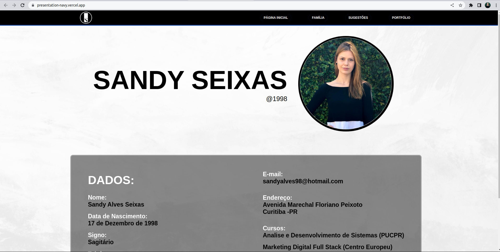

# Apresentação Pessoal — Sandy Seixas

Site de apresentação pessoal desenvolvido em **Vue.js** durante o **Snow Academy 2023**. Foi meu primeiro projeto com Vue e marca o início da minha jornada no desenvolvimento front-end.

🔗 **Acesse:** [presentation-navy.vercel.app](https://presentation-navy.vercel.app/)



## Sobre o projeto

O objetivo foi colocar em prática os conceitos aprendidos no curso: componentização, rotas e estilização. O site tem três páginas:

- **Home**: apresentação, contato e links para GitHub, LinkedIn e Instagram
- **Sugestões**: recomendações de livros
- **Pets**: meus pets 🐾

## Tecnologias


- [Vue 3](https://vuejs.org/) + [Vue Router](https://router.vuejs.org/)
- [Vite](https://vitejs.dev/) para desenvolvimento e build
- Deploy no [Vercel](https://vercel.com/)

## Como rodar localmente

Pré-requisito: [Node.js](https://nodejs.org/) instalado.

```bash
# clone o repositório
git clone https://github.com/SandySei/Apresentacao-Pessoal.git
cd Apresentacao-Pessoal

# instale as dependências
npm install

# rode em modo de desenvolvimento
npm run dev
```

Outros comandos:

| Comando           | Descrição                              |
| ----------------- | -------------------------------------- |
| `npm run build`   | Gera a versão de produção em `dist/`   |
| `npm run preview` | Serve localmente a versão de produção  |

## Estrutura

```
├── arquivos/        # imagens usadas no site
├── src/
│   ├── components/  # Header, Footer, Backtotop
│   ├── views/       # páginas: Home, Sugestões, Pets
│   ├── router/      # configuração de rotas
│   └── App.vue
└── vite.config.js
```

## Contato

[](https://www.linkedin.com/in/sandyseixas)
[](https://github.com/SandySei)

Feedbacks são bem-vindos! Fique à vontade para abrir uma issue ou entrar em contato.
